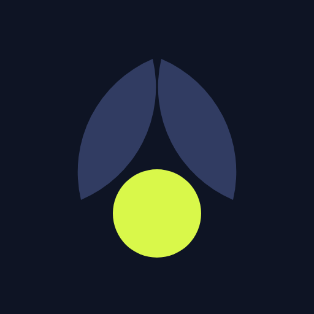

# Brand

## The mark

A firefly at rest, seen from above: two folded wings and a glowing tail.

The wings are muted and the glow is the only bright thing in the frame. That's the product in one image: in a dark, quiet room (the "Vancouver Freeze"), Firefly makes one signal visible: *I'm here, and I'm open to meeting people.* Fireflies light up so others like them can find them. The upward chevron of the wings also reads as rising, moving forward.

## Colors

| Name  | Hex       | Use |
|-------|-----------|-----|
| Night | `#0E1424` | Backgrounds, text on light |
| Glow  | `#D9F84A` | The light. Use sparingly: one glow per composition |
| Wing  | `#313C62` | Wings on dark backgrounds |

On light backgrounds, the glow becomes Night and the wings become `#C9CFDE` (see `firefly-mark-light.svg`, which includes an opaque `#F5F6F0` background). Glow on white has too little contrast for text or an essential interface indicator.

## Files

| File | Use |
|------|-----|
| `firefly-logo.svg` / `firefly-logo-512.png` / `firefly-logo-1024.png` | Primary. GitHub org avatar, social profiles, app icon |
| `firefly-mark-transparent.svg` | Mark only, for dark surfaces |
| `firefly-mark-light.svg` | For light surfaces |
| `firefly-mark-mono.svg` | Single-color (Night), for print or embossing |

## Rules

- Don't add gradients, glows, or outer shadows. The flat dot *is* the light.
- Keep the primary glow chartreuse; the supplied light and monochrome variants are the exceptions.
- Keep clear space of at least the glow's radius around the mark.

## Typeface

**Host Grotesk** (SIL Open Font License; licence in `src/assets/fonts/OFL.txt`), a clean neo-grotesk used for everything from display to small labels. It is self-hosted, never loaded from a font CDN. Display type is set large and tight (about -0.04em tracking) in regular weight; size, not boldness, carries hierarchy. Adopted 2026-11-25 with the landing page; [DESIGN.md](../DESIGN.md) holds the full type scale.

## The motif: fireflies in step

Some firefly species flash at random when apart and gradually flash in unison when they stay together. Firefly uses that as its visual story: a dark field of faint, independently blinking dots (strangers), five of which gather into a pod, turn Glow and fall into step week by week. It's the brand promise, repetition becoming friendship, made visible. On the landing page it is modelled with the Kuramoto synchrony model (`src/lib/fireflies/`).

- The crowd is drawn in the light Wing colour (`#C9CFDE`) at low opacity. Only the pod is Glow, so the screen still has one light.
- Dots are flat circles. A flash is shown by size and opacity, never by blur or bloom.
- With reduced motion, show the end state: the pod gathered, lit and in step.
